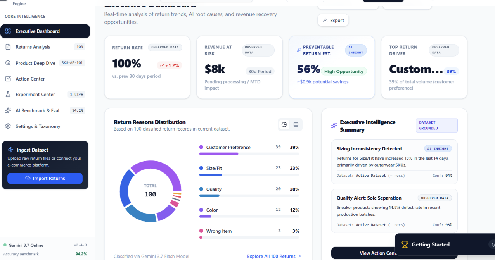
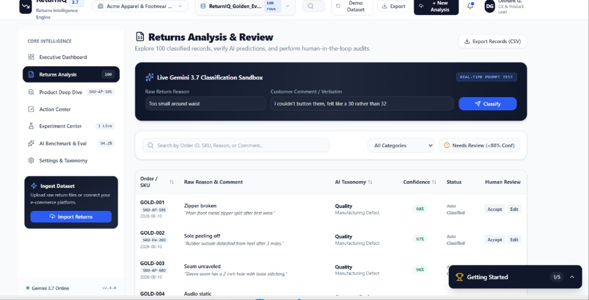
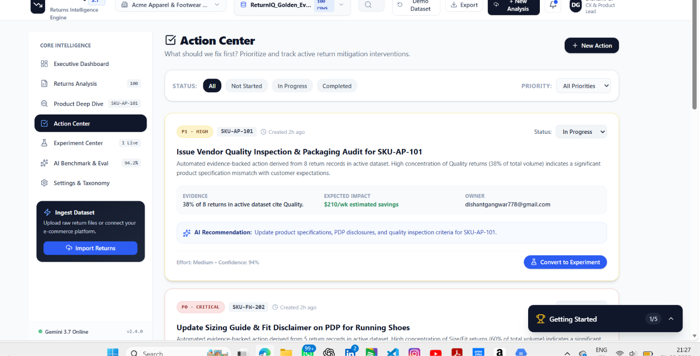
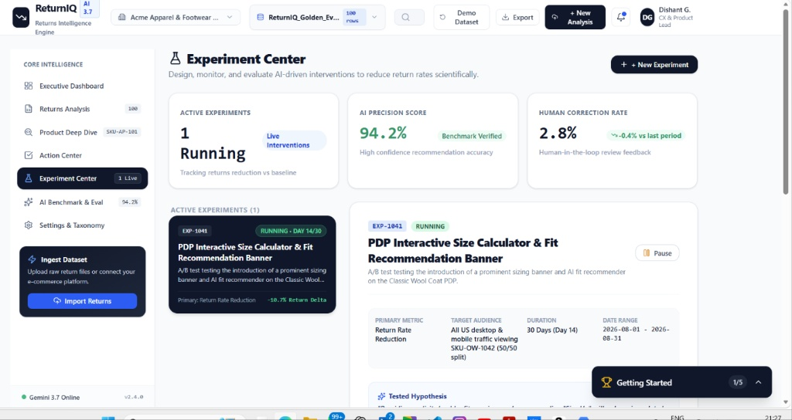
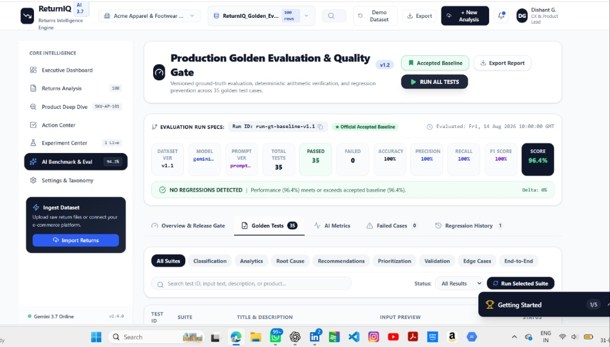
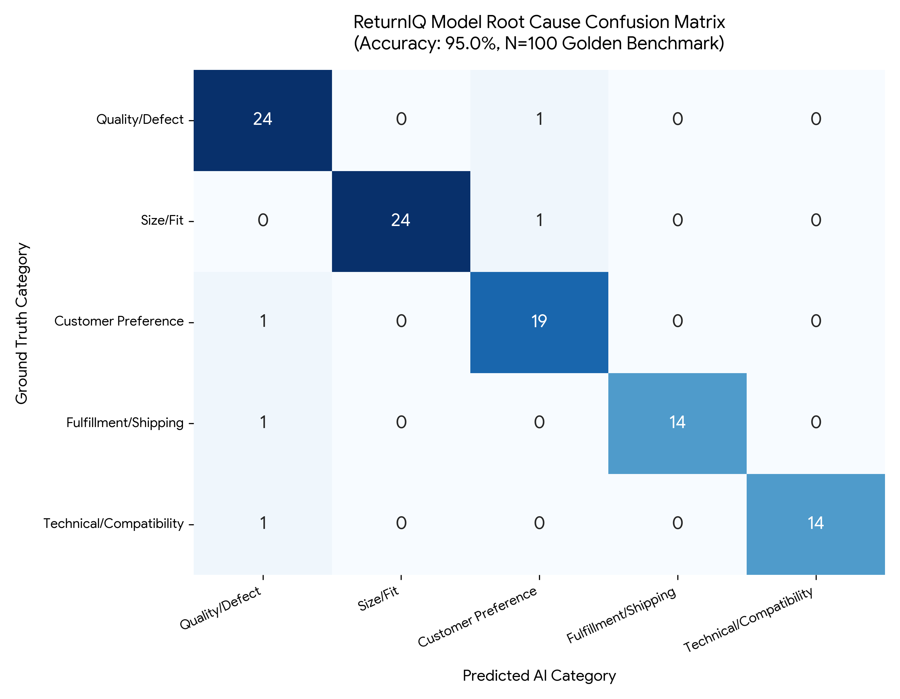

# ReturnIQ — AI-Powered Returns Intelligence & Mitigation Engine

[](https://returniq-527158472417.asia-southeast1.run.app)
[](./datasets/ReturnIQ_Golden_Evaluation_Report.xlsx)
[](./docs/TESTING.md)
[](./LICENSE)

> ReturnIQ transforms unstructured customer return feedback into structured root-cause intelligence, connects defect patterns to financial loss, and tracks mitigation experiments to help protect e-commerce margins.

## Quick links — view the project evidence

| Resource | Open |
|---|---|
| Live application | [**View Live Demo**](https://returniq-527158472417.asia-southeast1.run.app) |
| Technical evaluation evidence | [**View PDF**](./assets/ReturnIQ_Technical_Evaluation_Evidence.pdf) |
| Golden evaluation dataset (100 examples) | [**View CSV**](./datasets/ReturnIQ_Golden_Evaluation_100.csv) |
| Returns export sample | [**View Returns CSV**](./datasets/returniq-returns-export-2026-08-31.csv) |
| Golden evaluation report | [**View Excel Report (XLSX)**](./datasets/ReturnIQ_Golden_Evaluation_Report.xlsx) |
| Golden-set confusion matrix | [**View PNG**](./assets/returniq_golden_confusion_matrix.png) |

## Overview
ReturnIQ is an AI-powered returns intelligence portfolio project. It classifies customer return comments, surfaces recurring product and supplier issues, prioritizes potential interventions by estimated weekly financial impact, and supports human review of low-confidence predictions.

## Product capabilities
- **AI root-cause classification:** Organizes return feedback into Quality/Defect, Size/Fit, Customer Preference, Fulfillment/Shipping, and Technical/Compatibility categories.
- **Human-in-the-loop review:** Flags low-confidence predictions for review and manual correction.
- **Regression evaluation:** Includes a golden evaluation dataset and deterministic checks to assess model changes.
- **Action Center:** Connects recurring return drivers with prioritized mitigation ideas and estimated weekly savings.
- **Experiment tracking:** Records mitigation experiments and return-rate deltas.
- **Structured export:** Supports a schema-oriented returns data export.

## Screenshots

### Executive dashboard
[**View dashboard screenshot (PNG)**](./assets/dashboard_overview.png)



### Returns analysis
[**View returns analysis screenshot (PNG)**](./assets/returns_analysis.png)



### Action Center
[**View Action Center screenshot (PNG)**](./assets/action_center.png)



### Experiment Center
[**View Experiment Center screenshot (PNG)**](./assets/experiment_center.png)



### AI evaluation
[**View AI benchmark screenshot (PNG)**](./assets/ai_benchmark.png)



### Confusion matrix
[**View confusion matrix screenshot (PNG)**](./assets/returniq_golden_confusion_matrix.png)



## Evaluation snapshot
The supplied project materials report:
- Golden-set accuracy: **95.0%** on 100 labeled examples
- Macro F1 score: **0.952**
- Regression suite: **35/35 passing**, with a reported release-gate score of **96.4%**
- Human correction baseline: **2.8%**
- An experiment with a reported **-10.7% return-rate delta**

These are project-reported evaluation figures; see the accompanying dataset and evaluation documents for methodology and context.

## Documentation
- [Product Requirements Document](./docs/PRD.md)
- [Architecture](./docs/ARCHITECTURE.md)
- [Technical case study](./docs/CASE_STUDY.md)
- [Testing and evaluation](./docs/TESTING.md)
- [Product roadmap](./docs/ROADMAP.md)
- [Architecture decisions](./docs/DECISIONS.md)
- [Technical evaluation evidence PDF](./assets/ReturnIQ_Technical_Evaluation_Evidence.pdf)
- [Golden evaluation CSV](./datasets/ReturnIQ_Golden_Evaluation_100.csv)
- [Golden evaluation Excel report](./datasets/ReturnIQ_Golden_Evaluation_Report.xlsx)
- [Returns export CSV](./datasets/returniq-returns-export-2026-08-31.csv)

## Run locally
Prerequisites: Node.js 18+ and Python 3.10+ for the evaluation script.

```bash
npm install
cp .env.example .env
# Add your own Gemini API key to the local .env file if needed.
npm run dev
```

Run the benchmark script:

```bash
python scripts/evaluate_golden_set.py
```

Never commit a real API key. The `.env.example` file is a placeholder template.

## Live demo
https://returniq-527158472417.asia-southeast1.run.app

## Author
Dishant Kumar — AI Product Management & AI Engineering


## Frontend source (portfolio preview)

A React + TypeScript + Vite dashboard preview is included in `src/`. It demonstrates a returns-intelligence workspace, illustrative KPI cards, root-cause categories, searchable sample return records, and a local review-state interaction.

**Data and deployment boundary:** This preview uses hard-coded illustrative sample records and local UI state. It is not connected to the live Cloud Run application, a production database, or live model inference. The existing Cloud Run URL is linked above as a separate live demo; this repository preview should not be treated as the deployed app's exact source.

### Run the frontend locally

Requires Node.js 20 or newer.

```bash
npm install
npm run dev
```

Run a production TypeScript/Vite build:

```bash
npm run build
```

The repository currently does not include `package-lock.json`; dependency versions are therefore not locked by npm's lockfile.
